# Hermes Wear OS

**Your Wear OS watch talks directly to your own AI gateway.** No phone companion, no cloud relay, no
Telegram in the middle. Press the orb, say a thing, and a real agent on your own box — with real tools,
memory, cron jobs, and your files — answers on your wrist, out loud, before your hand leaves the glass.

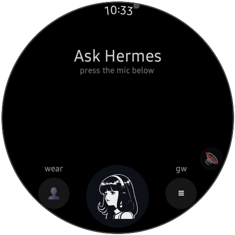

Everything heavy runs on your gateway. The watch streams text in, streams tokens back, renders the
answer (markdown, code, tables, **mermaid**, full-res images), and speaks it with an on-device voice.
The whole app is ~1 MB of Kotlin + a zero-dependency Node helper on the server side.

*Works with any [Hermes](https://github.com/borealBytes) gateway exposing its API server; the watch
needs nothing but HTTP on your LAN or tailnet.*

<br clear="all"/>

## Why this exists

Your assistant shouldn't have to phone home to survive. This stack is *yours* end to end: the model,
the gateway, the watch client, the microphone path — all self-hosted, default-configured to leak
nothing. Voice stays on the watch unless you explicitly send audio to your own server. Replies stream
over your LAN or your tailnet, never through a third-party relay, and the cache on the watch is
encrypted and bounded. It's the "own your stack" demo that lives on your wrist.

## What you get

| | |
|---|---|
| 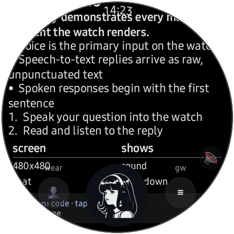 | 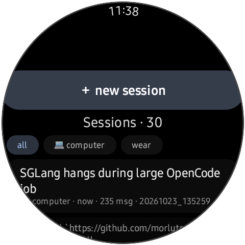 |
| **Streaming markdown**, rendered for a round screen: headings, bold, bullets, numbered lists, tap-to-expand code chips, and real two-column tables (bold header, hairline, aligned cells) — wider tables degrade to readable rows, because a grid of pipes on 1.4 inches is a crime. Pinch to scale text (double-tap resets); media keeps its own zoom. | **Sessions, from your wrist** — browse and adopt desktop/server sessions (`💻`), with their history backfilled; filters, resume, one-tap new. |
|  | 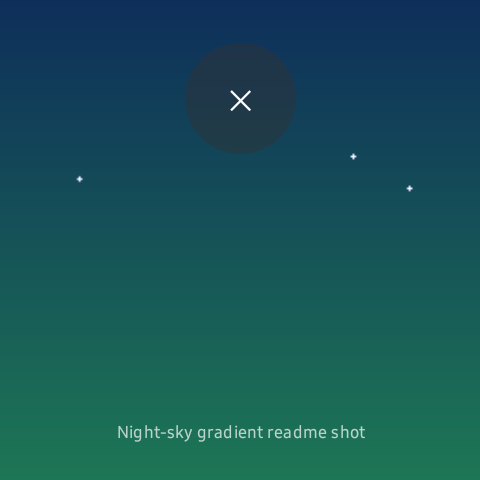 |
| **Images at full resolution** — the agent draws, the watch decodes and shows it. Tap to open the viewer. | **Zoom viewer** — double-tap or pinch to zoom, drag to pan below fit, tap anywhere to close. |
| 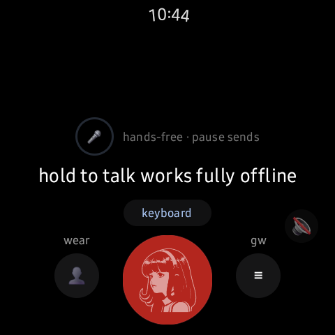 |  |
| **Hold-to-talk** — long-press the orb for push-to-talk with live on-device partials. Tap it for hands-free VAD mode. | **Kill mid-run** — the orb turns red while a run streams; press it and the *server-side* run cancels, not just the UI. |
|  |  |
| **Mermaid diagrams render** — architecture answers come back as pictures, via a gateway render helper (and cached). | **A real assistant** — your gateway's persona, tools, memory, and cron output; here, a debug conversation resumed from a desktop session. |

Plus: a GBoard prompt editor for long asks (with a big `Send`), tap-any-old-message edit-and-resend,
TTS that speaks every reply by default (mute satellite on the rim), gateway notifications with approve
buttons, and a diagnostics screen in Settings.

## Anatomy of a round trip

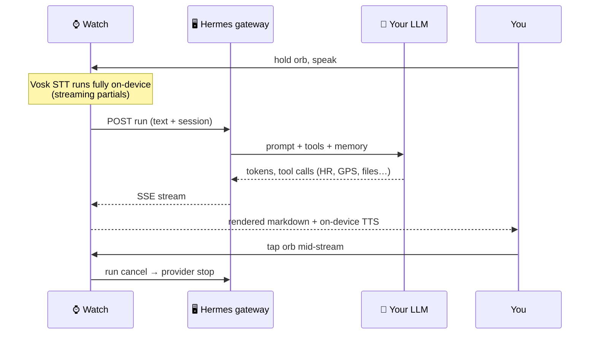

## Architecture

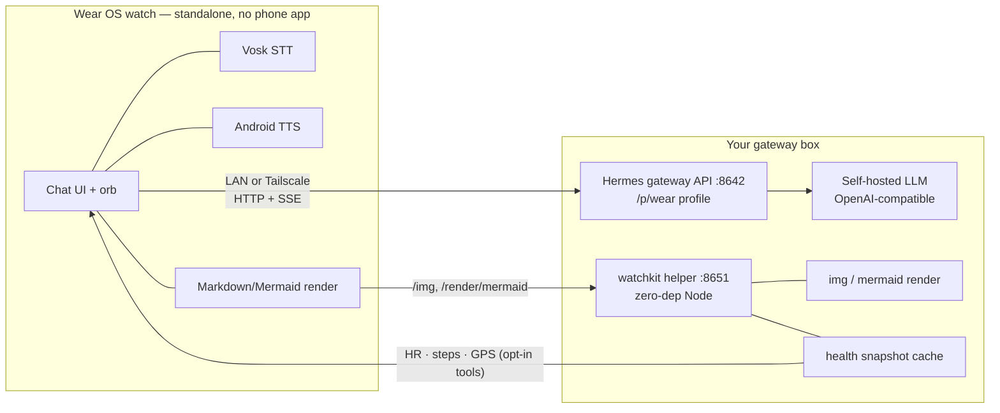

Three moving parts:

| Piece | What it is |
|---|---|
| `app/` | The watch app. Kotlin, Wear Compose, OkHttp/SSE. No Google services, no Firebase, no push. |
| Hermes gateway | Any Hermes install: point it at a profile (e.g. `wear`) with a persona, tools, and an API key. SSE run streaming + cancel. |
| `server/watchkit/` | Optional zero-dependency Node daemon: mermaid → PNG, full-res `/img` serving from allow-listed roots, opt-in body-tool snapshot cache (+ MCP for the agent), cron/job probes. |

## Voice, honestly

There is no free, offline, *perfect* STT on a watch today. Here's the truth ladder:

| Path | Where audio goes | Quality | Default |
|---|---|---|---|
| **Vosk `small-en-us`** | never leaves the watch | Good, not great. Nails short commands and dictation you speak *at* it; garbles names and mumbles. Clear speech, or edit-and-resend. | ✅ primary |
| **Gateway whisper** (`watchkit /stt/whisper`) | your own LAN/tailnet, your own box | Noticeably better — but the endpoint is opt-in and the automatic low-confidence fallback is **not wired into the app loop yet** (endpoint is live; see roadmap). | off |
| **GBoard typing → its mic** | Google's cloud | Best raw accuracy available on the watch — at the cost of Google hearing it. | your choice |

TTS is the opposite story: Android's on-device TTS is default **on**, so replies come back *spoken*
without touching a cloud voice. Mute is one satellite tap away.

## Networking: LAN at home, tailnet everywhere

The watch holds an ordered list of gateway endpoints (e.g. `tailnet → LAN`) and probes every endpoint
on a fixed cadence. First healthy endpoint wins, stays sticky, and every API call + image fetch rides
the same winner so you never get split-brain rendering. Everything is visible and editable on the
watch — Settings ▸ Gateways is a real multi-gateway manager, not a single URL box:


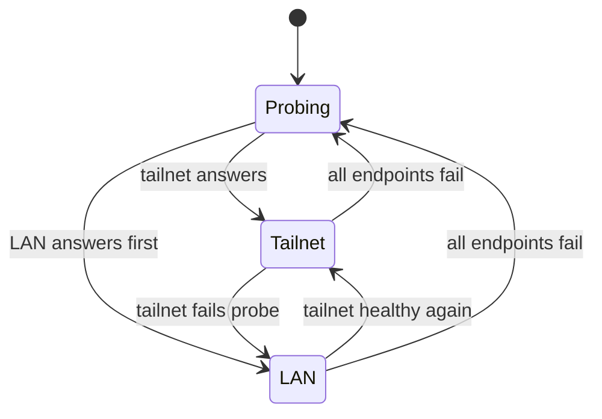

| Mode | You get | Setup |
|---|---|---|
| **LAN** (`http://192.168.1.50:8642`) | fastest, zero deps | gateway listens on your LAN; done |
| **Tailnet** (`http://hermes.tailnet.ts.net:8642`) | answers from anywhere your watch has wifi | run `tailscale` on the gateway box; the watch just resolves the name |

The watch itself does *not* need Tailscale today — it reaches the tailnet URL through ordinary DNS
when the watch sits on the tailnet (or a router that does). An embedded in-app tsnet node (watch joins
the tailnet directly, no router help) is specced and deferred; see [SPEC §11.4](docs/SPEC.md).

Inside a gateway, the endpoint editor shows the ordered list with live probe dots and the current
auto-selected winner:

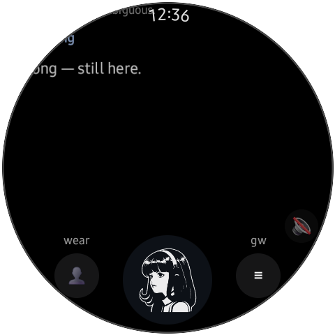

## Body tools (opt-in, owner-off by default)

The watch can feed its own sensors to the agent — behind four independent toggles, all default **off**:

| Tool | Toggle | Data path |
|---|---|---|
| `watch_heart_rate` | Body tools ▸ Heart rate | Health Services → signed snapshot → gateway → agent |
| `watch_steps` | Body tools ▸ Steps | same, with daily counter semantics |
| `watch_location` | Body tools ▸ Location | one-shot GPS fix (fresh on chat-ask, last-known on timers) |
| auto-attach digest | Body tools ▸ Attach with questions | piggybacks the digest on each ask, battery-aware |


Snapshots are pushed over TLS to *your* watchkit, cached server-side with a freshness cap, and exposed
to the agent as both MCP-style tools and raw JSON. Nothing is forwarded anywhere else. On Samsung,
Health Services currently exposes heart-rate and steps only — no sleep/SpO2 — and its `DataType`
constants are matched tolerantly (real-world crashes taught us that). On non-Samsung vendors the
toggles simply report "vendor not available" and everything else keeps working.

Everything about the app — gateways, tokens, toggles, font scale, session — lives on the watch.
Every knob is on-device, and there are no hidden ones:

| | |
|---|---|
| 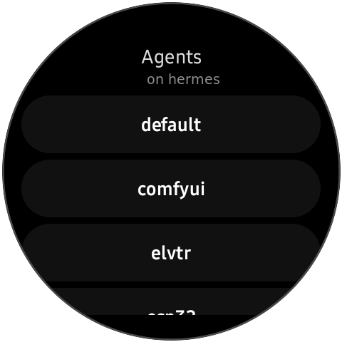 | 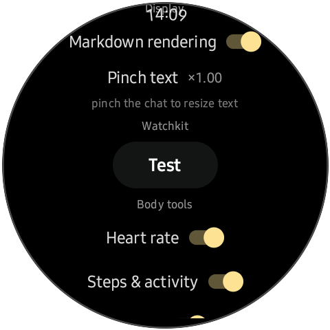 |
| **Agent switcher** — the watch talks to whichever Hermes profile you pick (one tap switches persona, tools, session space, and base URL together). | **Display settings** — markdown toggle, text scale (`×1.00` + reset), and the pinch affordance documented in one line. |
| 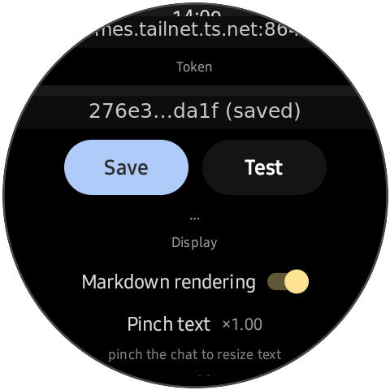 | 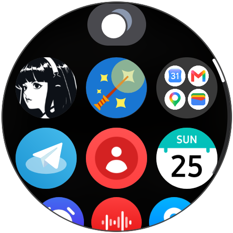 |
| **Connection editor** — base URL + token (masked at rest, like a password field should be) with a live **Test** button; watchkit config lives right beside it. | **Nothing to install on the phone** — the whole assistant is one icon on the watch's app grid. |

The diagnostics screen is the support story: STT model present ✅, TTS engine ready, last push status
with bytes and age, health-services availability, location fix state. Location is redacted here for
the screenshot, honest as you can see — your house shouldn't be in a README:


## Install — let your agent do it

This repo is built to be installed by *your AI coding agent* (the file `AGENTS.md` is its contract —
read it to your agent, or let it read the repo). Paste this into OpenCode / Claude Code / Codex at
your gateway machine:

```text
Install this for me: git clone https://github.com/borealBytes/hermes-wearos && cd hermes-wearos
Read AGENTS.md and follow it end to end: bootstrap the toolchain, build the APK, configure
watchos.config.json from my Hermes profiles, install to the watch (wireless debug — expect the
port to rotate, use the chunked-push recipe), then verify health + one ask end to end. Interview
me only for what you cannot detect.
```

The script equivalent, if you prefer doing it by hand:

```bash
scripts/bootstrap.sh                    # JDK + Android SDK + gradle, folder-local, no root
cp watchos.config.example.json watchos.config.json   # your endpoints + token (gitignored)
scripts/setup.sh                        # build → install → push config → health-check
```

`setup.sh` knows the ugly parts: wireless-debug port rotation on real watches, chunked
`split -n l/14` installs with md5 verification (single-pipe pushes on flaky wifi links die mid-flight),
`svc power stayon` + `deviceidle disable` hardening, and token auto-detect from
`~/.hermes/profiles/wear/.env` when the gateway is this same machine. `--dry-run` shows the plan first.

<details>
<summary>What <code>AGENTS.md</code> covers (the contract your agent gets)</summary>

- prereq detection (JDK, SDK, adb, optional emulator via `scripts/emulator.sh`)
- interview *only* unknowables (endpoints, which profile); auto-detect tailscale FQDN, `API_SERVER_KEY`
- the real-watch install recipe (port rotation warning, hardening one-liners, chunked push + md5)
- config push over `DevAskReceiver` debug extras (token, gateways, watchkit, brief job id)
- verify checklist: `/health` 200, one streamed ask round-trip, one screenshot
- troubleshooting table (offline device ⇒ rotated port; EOF pushes ⇒ chunked; degraded sessions row, etc.)

</details>

## Gateway-side setup (5 minutes, once)

```yaml
# ~/.hermes/profiles/wear/config.yaml  — minimal
toolsets: [hermes-cli]
mcp_servers:
  hermes-watchkit:
    command: node
    args: ["/path/to/hermes-wearos/server/watchkit/watchkit.mjs"]
# ~/.hermes/profiles/wear/.env
API_SERVER_KEY=<64-hex>          # what the watch authenticates with
```

Persona: copy `docs/wear-SOUL.example.md` to `~/.hermes/profiles/wear/SOUL.md` and make it yours —
it teaches the agent to answer short, mark down-lite, unicode math, never LaTeX, and to render
mermaid as fence blocks (the watch renders them). Start the watchkit helper with
`scripts/watchkit.sh` or the bundled `server/watchkit/hermes-watchkit.service`.

## Privacy

- **Audio stays on-device** in the default config (Vosk). Whisper fallback sends audio to *your* gateway only. GBoard's mic is Google — documented, opt-in.
- **TTS is on-device** by default (no cloud voice calls).
- Text + run streaming go **only** to your configured gateways over LAN/tailnet.
- On-watch cache is **encrypted at rest and size-bounded**; delete = app data wipe.
- Body data flows **only** when you flip the toggles; snapshots push to your watchkit, nowhere else.
- No analytics. No crash reporter. No push tokens. `grep` for tracking SDKs: nothing.

## Develop

```bash
source scripts/env.sh
../devkit/gradle/current/bin/gradle :app:assembleDebug :app:testDebugUnitTest   # 175 tests
scripts/emulator.sh                        # optional headless Wear emulator
scripts/doctor.sh                          # toolchain + link health report
```

- `docs/SPEC.md` — the full architecture spec **and Appendix A: an unexpurgated build log** (every
  trap hit: Wear Compose 1.4.1 quirks, 32-bit-only watch ABI, Samsung `DataType` name drift, SLC
  anchor fights, flaky wireless debug installs). If you build for watches, read it before fighting the
  same ghosts.
- `app/src/debug/.../DevAskReceiver.kt` — adb-broadcast harness (`-e text '...'`, `-e ptt_demo`,
  `-e fontscale`, `-e agent …`): scriptable end-to-end demos, which is exactly how every screenshot
  in this README was captured.
- Target: Wear OS 5+ (API 33+), round. Physical-verified on a Galaxy Watch Ultra (Wear OS 6,
  480×480, 32-bit userspace → `armeabi-v7a`).

## Limitations & roadmap

- [ ] **Whisper auto-fallback** wired into the voice loop (endpoint exists today; app-side confidence gate is next).
- [ ] **tsnet node** in-app: watch joins your tailnet itself — no tailscale router required (gomobile shim over `tsnet`, ~1 dev-day, specced in SPEC §11.4).
- [ ] Play-store signing + R8 hardening pass; today it's a debug-build project.
- [ ] Complications + tile. On-wrist launch currently = app icon (or voice link).
- [ ] Six-digit pairing flow polish (S5) for first-run UX on a stranger's watch.
- [ ] Wear-side mermaid fallback when the gateway render helper is offline.

## Built with

- **OpenCode** driving development end to end — **against a self-hosted `Qwen3.8-Flash-Next-Uncensored`
  served locally by SGLang**. Yes: this app was mostly written by a local model talking to a local
  agent harness, on the same machine it serves the watch from. The build log in
  `docs/SPEC.md` Appendix A is that collaboration's fossil record (including the moment the gateway
  agent **self-patched its own watch client** to add a feature nobody asked for — and the owner, with
  final say, deleted it at 11:47 the same morning).
- Wear Compose 1.4.1, OkHttp + SSE, `androidx.health`, Vosk, nothing else you'd spot in a
  dependency audit.

## License

MIT — see [LICENSE](LICENSE). Screenshots were captured on a physical Galaxy Watch Ultra; the demo
chats use neutral scripted prompts (the `lat/lng redacted` marker is exactly what it claims).
